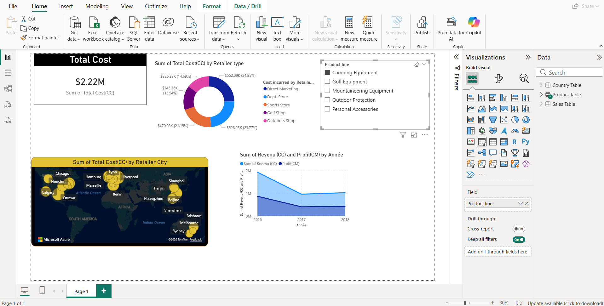

# Retail Sales Power BI Dashboard

A single-page Power BI report analysing retail sales costs, revenue and profit by product line, retailer type, city and year. It was built during a Business Intelligence course at ESPRIM (Monastir, Tunisia) on an Excel dataset provided in the course.

The report is versioned as a **Power BI Project (`.pbip`)**: the semantic model is stored in TMDL and the report in PBIR (JSON), so every change to a measure or visual is readable in the git history.



## What the report shows

| Visual | Content |
|---|---|
| Card | Total Cost |
| Donut | Total Cost by retailer type (Dept. Store, Direct Marketing, Sports Store, Golf Shop, Outdoors Shop) |
| Slicer | Product line (Camping Equipment, Golf Equipment, Mountaineering Equipment, Outdoor Protection, Personal Accessories) |
| Map | Total Cost by retailer city |
| Area chart | Revenue and Profit by year (2016–2018) |

Total Cost by product line, as displayed by the report:

| Product line | Total Cost |
|---|---|
| Camping Equipment | $2.22M |
| Mountaineering Equipment | $726.86K |
| Personal Accessories | $443.93K |
| Golf Equipment | $287.37K |
| Outdoor Protection | $73.29K |

## Data model

Source: `data/sales_data_amz.xlsx`, three sheets imported with Power Query.

- **Sales Table** (fact): Transaction Date, Retailer City, Order method type, Urgent?, Retailer type, Product Code, Sale Price, Quantity Sold.
- **Product Table** (dimension): Product Code, Product line, Product type, Product, Product Cost.
- **Country Table**: Country, City (duplicates removed on City).

Relationships: `Sales Table[Product Code]` → `Product Table[Product Code]`, and `Sales Table[Transaction Date]` → auto date table.

Calculations (DAX):

| Name | Type | Definition |
|---|---|---|
| Product Cost (CC) | Calculated column | `RELATED('Product Table'[Product Cost])` |
| Revenu (CC) | Calculated column | `Quantity Sold × Sale Price` |
| Total Cost(CC) | Calculated column | `Quantity Sold × Product Cost (CC)` |
| Profit(CM) | Measure | `SUMX('Sales Table', [Revenu (CC)] - [Total Cost(CC)])` |

Power Query cleaning on the sales sheet: two title rows skipped, headers promoted, empty rows removed, missing quantities set to 0, rows with errors in Quantity Sold removed, columns renamed (`Trans Date` → `Transaction Date`, `RetCity` → `Retailer City`, `Value` → `Sale Price`).

## Correction

The first version of `Profit(CM)` multiplied revenue by cost (`Revenu × Total Cost`), which pushed the profit axis into billions while costs were in millions. It now subtracts cost from revenue. After the fix, profit is positive and lower than revenue for every product line and year.

## Limitations

- **Country Table is not related** to the sales table and is not used by any visual. The map uses `Retailer City` from the sales table directly.
- **Absolute file path**: the Power Query source points to `C:\projects\retail-sales-powerbi-dashboard\data\sales_data_amz.xlsx`. If you clone elsewhere, change the source (see below).
- **Course dataset**: small, static, three years (2016–2018). No forecasting, no external data.
- Dates use Power BI's automatic date table rather than a dedicated calendar table.

## How to open

Requirements: Power BI Desktop with *Power BI Project (.pbip) save option* enabled (File → Options → Preview features).

```powershell
git clone https://github.com/Abd-Elmouhib-Souri/retail-sales-powerbi-dashboard.git C:\projects\retail-sales-powerbi-dashboard
Start-Process "C:\projects\retail-sales-powerbi-dashboard\retail-sales-dashboard.pbip"
```

If you cloned to another folder: **File → Options and settings → Data source settings → Change Source…**, select `data\sales_data_amz.xlsx`, then **Home → Refresh**.

## Repository structure

```text
retail-sales-powerbi-dashboard/
├── data/sales_data_amz.xlsx                 # source data (course-provided)
├── docs/dashboard.png                       # report screenshot
├── retail-sales-dashboard.pbip              # open this file in Power BI Desktop
├── retail-sales-dashboard.Report/           # report definition (PBIR, JSON)
└── retail-sales-dashboard.SemanticModel/    # semantic model (TMDL)
```

The data cache (`.pbi/cache.abf`), local settings and any `.pbix` copy are excluded by `.gitignore`.

## Author

**Abd Elmouhib Souri**, engineering student at ESPRIM (Data Science, AI & Business Intelligence).
[GitHub](https://github.com/Abd-Elmouhib-Souri) · [LinkedIn](https://www.linkedin.com/in/abd-elmouhib-souri/)
